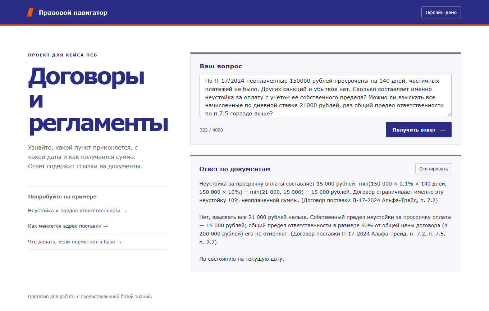
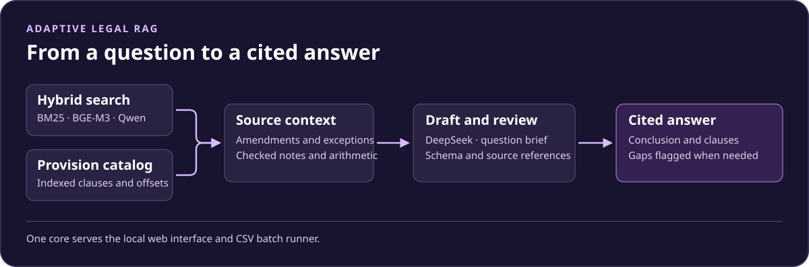

# Adaptive Legal RAG

A side project for answering questions about contracts, policies, and statutes from a local document collection. Ask which clause applies, when a rule takes effect, or how to calculate an amount. The assistant returns a short answer with references to the underlying provisions.

[](https://github.com/malekmasry/adaptive-legal-rag/actions/workflows/verify.yml)

[Run the demo](#run-the-demo) · [Explore the architecture](#architecture) · [Download the batch release](submission/psb-v243.zip)



*The screenshot shows a saved demo answer. The daily-rate calculation gives ₽21,000, and a contract clause caps the penalty at ₽15,000.*

## Run the demo

```sh
git clone https://github.com/malekmasry/adaptive-legal-rag.git
cd adaptive-legal-rag
docker compose up --build -d
```

Open [localhost:8080](http://localhost:8080), choose an example in the sidebar, and submit it. The Russian-language UI ships with three saved examples for contract penalties, an amendment that changes a delivery address, and a question the documents can only answer in part. Demo mode works offline after the image builds and requires neither API keys nor the source archive.

<details>
<summary>Run locally with Python 3.12</summary>

```sh
python -m pip install -r focused-rag/requirements.txt
python web/server.py
```

</details>

## Architecture



1. **Retrieve.** BM25 finds exact terms and document identifiers. BGE-M3 embeddings help with paraphrases. Reciprocal rank fusion combines candidate lists, and Qwen3-Reranker-8B reranks the results. A separate index can surface a specific provision outside the top results.
2. **Build context.** Add neighboring passages and relevant amendments. Check document fingerprints and verbatim excerpts before adding corpus-specific guidance. Supported calculations use Python's `Decimal`.
3. **Draft and review.** A question brief identifies the parts the answer needs to cover and builds citation options from the retrieved text. DeepSeek drafts the answer and a separate pass reviews it against the sources. The code validates response structure and source references. A validated draft can survive a failed review call.
4. **Return the answer.** Give the conclusion and cite the clauses. When evidence only covers part of a question, explain which part the collection cannot answer. The web UI and CSV runner use the same core.

### Source catalogs

A retrieved clause can depend on a condition in a different document. For example, a delivery amendment may apply based on when the specification was signed. The indexed contract terms, applicability notes, and amendment links make those dependencies explicit.

| Component | What it does |
| --- | --- |
| [Provision catalog](focused-rag/decision_catalog.json) and [decision index](focused-rag/decision_index.py) | Index 316 provisions with document fingerprints and text offsets so individual thresholds, exceptions, and clauses can be retrieved directly. |
| [Corpus playbook](focused-rag/corpus_playbook.json) | Provides 128 curated applicability notes across the 21 documents in the reference collection. Each note requires a matching source fingerprint and supporting excerpts. |
| [Amendment scopes](focused-rag/relation_scope.json), [relations](focused-rag/relations.yaml), and [aliases](focused-rag/aliases.yaml) | Connect affected clauses and editions, and help distinguish similarly named documents and parties. |
| [Answer guides](focused-rag/answer_guides.py) and [calculation checks](focused-rag/decision_checks.py) | Select evidence for supported question types and check arithmetic such as daily penalties, thresholds, and caps. |
| [Question brief and citations](focused-rag/question_brief.py) | Build a request-specific outline and citation candidates from the current question and retrieved passages. |

Changes to a source invalidate its fingerprint-dependent entries. The updated document remains available to the regular retrieval pipeline. Question text and retrieved documents are treated as input data, including any instructions embedded in them.

## Connect your documents

1. Copy [`.env.example`](.env.example) to `.env` and set `APP_MODE=live`.
2. Put your document archive at `data/knowledge-base.zip`.
3. Configure the endpoints, keys, and model IDs. Compose passes these settings to the local server.

   | Service | Environment settings |
   | --- | --- |
   | Generation and review | `LLM_BASE_URL`, `LLM_API_KEY`, `LLM_MODEL` |
   | Embeddings | `EMBEDDER_BASE_URL`, `EMBEDDER_API_KEY`, `EMB_MODEL` |
   | Reranking | `RERANKER_BASE_URL`, `RERANKER_API_KEY`, `RERANKER_MODEL` |

4. Start Compose again and enter a question in the UI. When starting Python directly, export these settings in the process environment.

`AS_OF` sets the date used for date-sensitive questions in `YYYY-MM-DD` format. The included web server is intended for local evaluation.

## Tests and batch runner

```sh
python -m pip install -r focused-rag/requirements.txt
python -m unittest discover -s focused-rag -p "test_*.py"
python build_focused_submission.py dist/submission.zip
```

Run a batch with the configured model services and document archive:

```sh
python focused-rag/solution.py --input data/questions.csv --output submission.csv
```

The input columns are `id,question`, and the output columns are `id,answer`. GitHub Actions checks the package against the original batch release, runs the unit suite, and exercises the demo API inside Docker.

| Path | Contents |
| --- | --- |
| [`focused-rag/`](focused-rag/) | Retrieval, catalogs, context, generation, review, and the CSV runner |
| [`web/`](web/) | Local interface, JSON API, and saved demo cases |
| [`submission/`](submission/) | Original v243 batch release |
| [`docs/`](docs/) | Project slides and README images |

## Authors

- [@malekmasry](https://github.com/malekmasry) · ML engineering
- [@moonvolk4](https://github.com/moonvolk4) · Pipeline development and benchmark tooling · ML engineering

The project began at a hackathon. The [original presentation](docs/Правовой-навигатор.pdf) documents the initial design in Russian.
